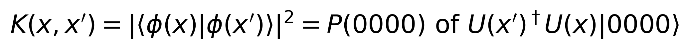

# PS-Q2: Quantum Kernel Estimator & Support Vector Machine (QSVM)

Compare the cost of evaluating a quantum fidelity kernel on two processor topologies:
**Processor A** (5-qubit linear chain) and **Processor B** (9-qubit heavy-hex-inspired graph).

## Problem statement (selected)
> Construct a quantum kernel matrix using fidelity state overlap `|<phi(x)|phi(x')>|^2` on a 4-qubit register.
> Train a classical SVM with the quantum kernel. Compare kernel evaluation cost on A vs B.
> Data: `sklearn.datasets.make_moons(n_samples=100, noise=0.1, random_state=42)`.



## Setup
```bash
git clone <your-repo-url> && cd <repo>
python -m venv .venv && source .venv/bin/activate      # optional
pip install -r requirements.txt
jupyter nbconvert --to notebook --execute main.ipynb --output main.ipynb    # or open main.ipynb and Run All
```
Run from the project root. Runtime is well under a minute. Everything is seeded (seed = 42).

## Processors
| | Processor A (baseline) | Processor B (contemporary) |
|---|---|---|
| Physical qubits | 5 | 9 |
| Topology | linear chain `0-1-2-3-4` | 12-edge heavy-hex-inspired graph |
| Layout of 4-qubit register | `[0, 1, 2, 3]` | `[0, 1, 6, 8]` (native 4-cycle `0-1-6-8-0`) |
| Basis gates | rz, sx, x, cx | rz, sx, x, cx |
| Noise (identical) | p1 = 0.001, p2 = 0.005, readout = 0.01 | same |
| Transpile | optimization level 1, seed 42, 4096 shots | same |

Configs live in `processors/processor_A.json` and `processors/processor_B.json`.

## Methodology
1. **Data**: `make_moons(100, noise=0.1, random_state=42)`, stratified 80/20 split, MinMax-scaled to [0, pi] (scaler fitted on train only).
2. **Feature map** (4 qubits): H + Rz(2x) encoding (`x[q % 2]` on qubit q), then a data-dependent ZZ-style ring entangler `CX - Rz(phi) - CX` on pairs (0,1), (1,2), (2,3), (3,0).
3. **Kernel**: compute-uncompute circuit `U(x')^dagger U(x)`; `K(x,x') = P(0000)`. The ideal kernel comes from statevectors; the noisy estimate from Aer with the noise model above.
4. **SVM**: `SVC(kernel="precomputed")` on the ideal kernel, with a classical RBF SVM as a baseline.
5. **Cost comparison**: the same 30 random training pairs are compiled and run on A and B. We record depth, CX count, compile and execution time, kernel error against the ideal value, and the binomial standard error. Routing overhead is measured against an all-to-all compile.

## Key results
**Classification (ideal quantum kernel, 20 test points):** accuracy 0.95, precision 1.00, recall 0.90, F1 0.947. The RBF baseline reaches 0.90.

**Kernel evaluation cost, A vs B (mean over 30 pairs):**

| Metric | Processor A | Processor B |
|---|---|---|
| Compiled depth | 34.8 | 27.7 |
| Compiled CX count | 23.9 | 13.8 |
| Mean time / evaluation (simulator) | 16.4 ms | 16.2 ms |
| Mean \|noisy - ideal\| | 0.0211 | 0.0168 |
| Kernel entries for full K_train + K_test | 4,840 | 4,840 |

**Routing overhead** (demo circuit): A needs 24 CX against 14 for the all-to-all reference (+10 CX, about 3 SWAPs). B needs exactly 14 (+0), because the feature-map ring embeds natively in its 4-cycle.

**Takeaway:** the same circuit costs about 42% fewer CX on B, and the noisy kernel is about 20% closer to the ideal one. Simulator wall-clock time is essentially equal and varies from run to run, so it is not evidence either way.

## Repository layout
```
README.md          this file
report.md          architectural analysis, trade-offs, limitations
main.ipynb         end-to-end experiment (executed, with outputs)
requirements.txt
data/raw/          generated make_moons inputs (.npy, .csv)
data/processed/    scaled train/test arrays and ideal kernel matrices
processors/        processor_A.json, processor_B.json
src/               problem.py, processors.py, routing.py, metrics.py, visualization.py
results/tables/    CSV/JSON benchmark tables
results/figures/   coupling graphs, cost comparison, routing overhead, kernel heatmap
assets/            rendered equation images
```
